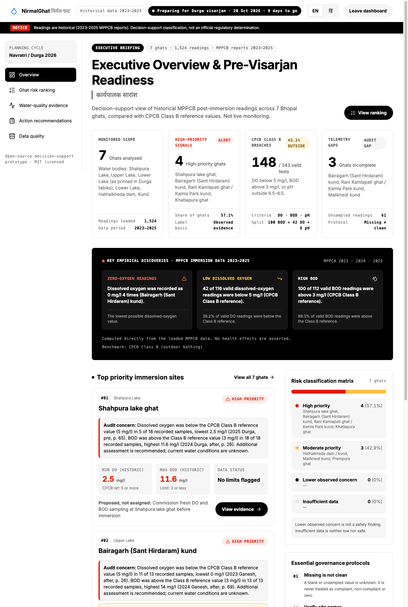
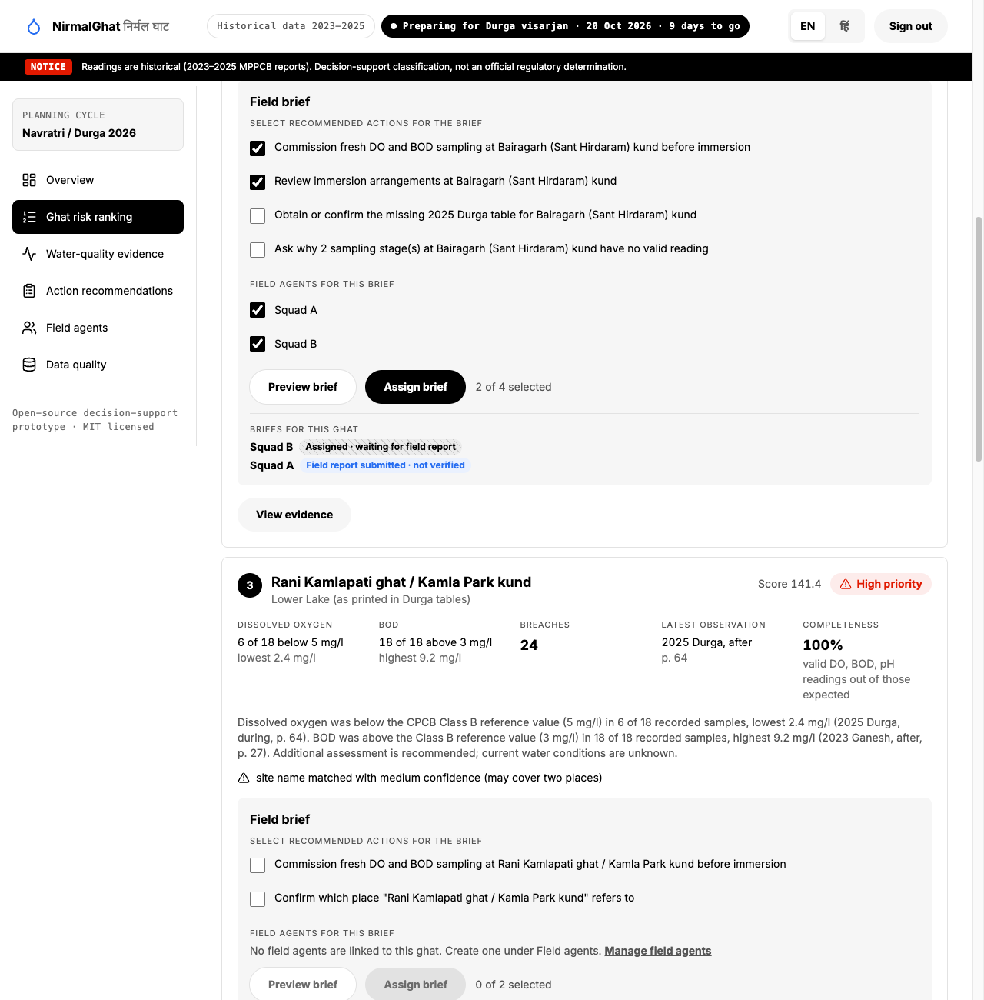
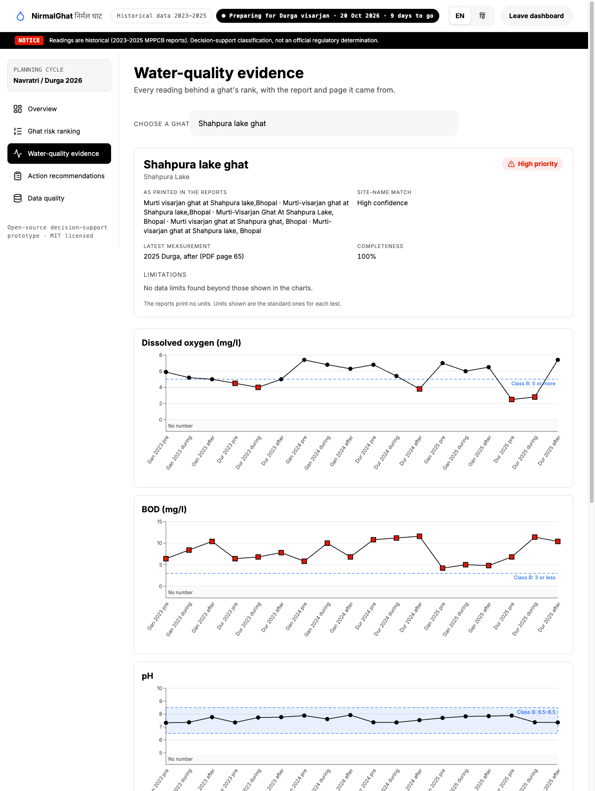
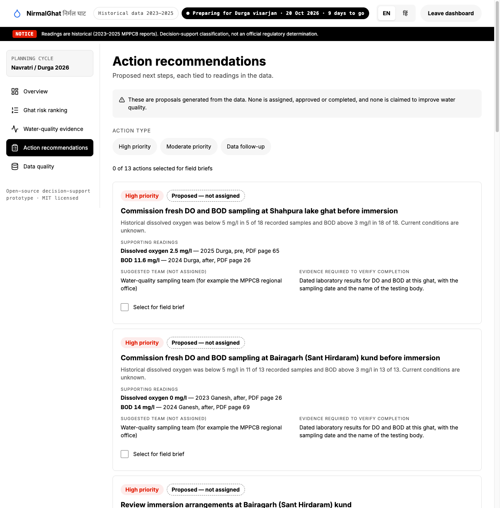
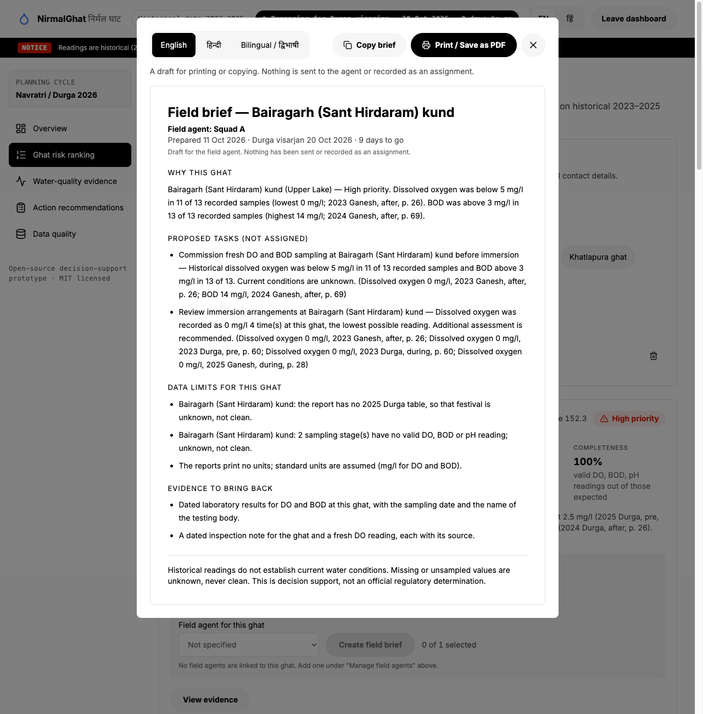
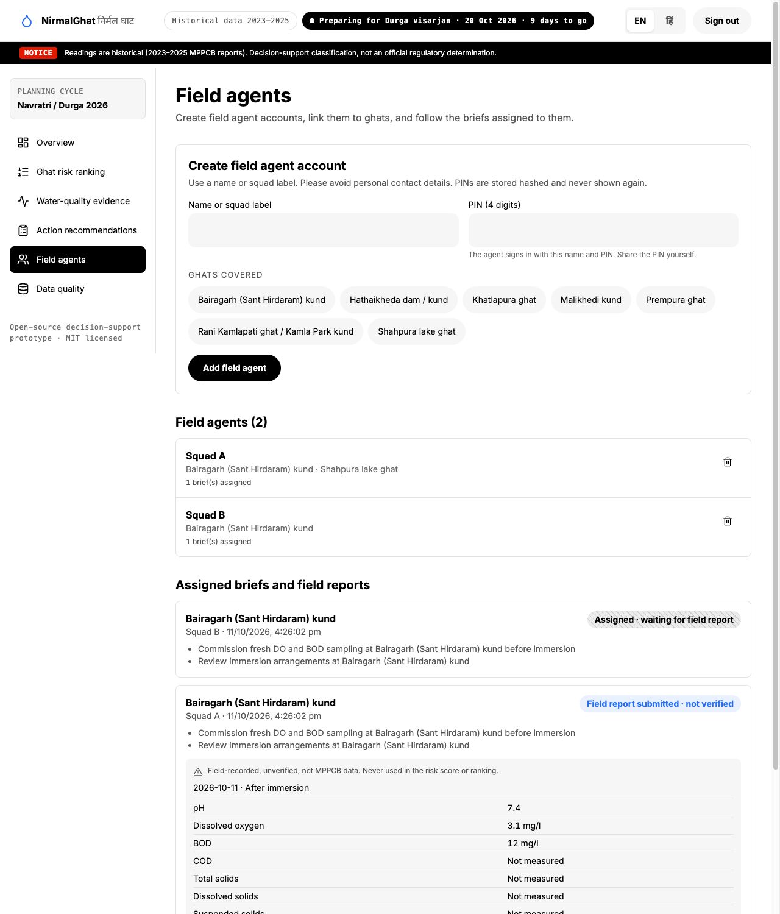
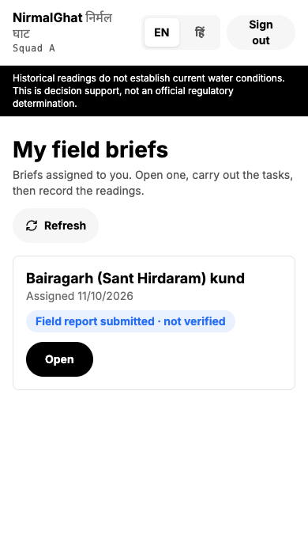
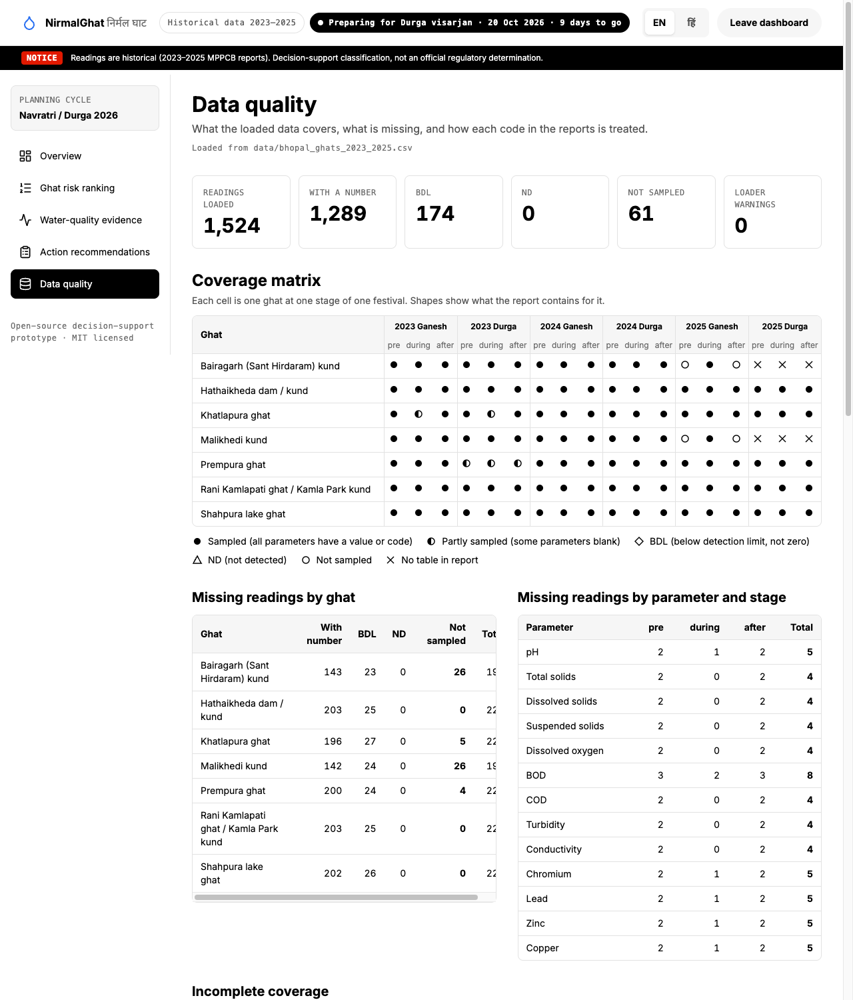

# NirmalGhat · निर्मल घाट

**Bhopal water-quality risk intelligence for visarjan ghats.**
Claude Impact Lab × Cerebras Café Compute, Bhopal · **Track 2 — Visarjan Ghat Watch**

> **Decision support, not an official regulatory determination.** NirmalGhat compares *historical* MPPCB readings (2023–2025) with CPCB Class B reference values. It says nothing about current water conditions, is not live monitoring, and is not connected to any government system.

| | |
|---|---|
| Team | _TODO: team name_ |
| Members | _TODO: names and roles_ |
| The one user | A **Bhopal Municipal Corporation (BMC) officer** preparing for **Durga visarjan, 20 October 2026** |

## The problem

MPPCB tests the water at Bhopal's idol-immersion ghats three times per festival (before, during, one week after) for Ganesh and Durga. The results sit in 90–120 page PDFs that nobody compares against the legal limits. NirmalGhat gives the officer, before 20 October:

1. a **ranked list of ghats** by historical risk, with a plain-language reason for each rank,
2. every reading **traceable to its report and PDF page**,
3. **proposed actions** tied to those readings, and
4. a short **Hindi + English field brief** per ghat, **assigned to one or more field agents**, who record new readings on a simple bilingual form after the visit.

Two roles: the **BMC officer** (analysis, agents, assignments) and the **field agent** (own briefs, report form). Workflow: *historical data → risk ranking → evidence review → proposed actions → assigned field brief → field report.*

## Screenshots

| Overview | Ghat risk ranking |
|---|---|
|  |  |
| **Water-quality evidence** | **Action recommendations** |
|  |  |
| **Field brief preview** | **Field agents (officer)** |
|  |  |
| **Field agent app (phone width)** | **Data quality** |
|  |  |

Sign-in page: [docs/screenshots/login.png](docs/screenshots/login.png).

## Run it in 5 steps

```bash
git clone <this repo>        # 1. get the code
cd nirmalghat                # 2. enter the folder
npm install                  # 3. install dependencies (Node 20+)
npm run dev                  # 4. start the app
# 5. open http://localhost:5173
```

Step 4 needs a one-time Supabase setup (below) for sign-in, field agents, assignments and field reports. Without it the app shows setup instructions instead of failing quietly. The ranking, evidence and brief data come from the CSVs and need no backend.

### One-time Supabase setup (free tier, about 5 minutes)

1. Create a project at <https://supabase.com>. In **Authentication → Providers → Email**, turn **off** "Confirm email" (agent accounts use a derived address that never receives mail).
2. Open **SQL Editor** and run [supabase/migrations/0001_nirmalghat.sql](supabase/migrations/0001_nirmalghat.sql), then [supabase/migrations/0002_ghat_locations.sql](supabase/migrations/0002_ghat_locations.sql) (map positions). They create the tables and the Row Level Security policies.
3. Create the officer: **Authentication → Users → Add user** (email + password, tick auto-confirm), then run in the SQL editor, with your email:
   ```sql
   update auth.users
   set raw_app_meta_data = coalesce(raw_app_meta_data, '{}'::jsonb) || '{"role": "officer"}'
   where email = 'officer@example.in';
   ```
4. Copy `.env.example` to `.env` and fill in the **Project URL** and the **anon public** key (Project Settings → API). `.env` is git-ignored. **Never** put the `service_role` key in this app or in git.
5. Restart `npm run dev`, then sign in as **BMC Officer**. The sign-in page shows a public demo officer login (`officer@bmc.com` / `Test@123`) for judges: create that user in step 3 with that password, or edit `DEMO_EMAIL` / `DEMO_PASSWORD` in `src/features/login/LoginPage.tsx`. Create field agents under **Field agents** (name or squad label, 6-digit PIN, ghats covered); they sign in as **Field Squad** with that name and PIN.

Checks: `npm run lint` · `npm run typecheck` · `npm run test` · `npm run build`

No paid services. The risk analysis runs in the browser from the CSVs in `public/data/`. Only sign-in, field agents, assignments and field reports use **Supabase** (free tier). The only value in `.env` is the project URL and the *public* anon key; nothing secret is stored in this repository.

## Key features

- **Overview** — four summary cards, key findings, top-3 ghats, risk-label distribution. Every number is computed from the loaded CSV, nothing is hardcoded.
- **Ghat map** (button on the Overview) — a real **OpenStreetMap** map (Leaflet, no API key) with a pin per ghat, coloured and numbered by risk label. The MPPCB data has no coordinates, so **none are invented**: an admin places each ghat on the map with **Set location**, and it is stored in Supabase (`ghat_locations`) as "position set by admin". Ghats without a position are listed as "Location not set". Below the map each ghat is shaded by historical risk score (MPPCB readings only; "Insufficient data" is hatched, never shaded) and lists its agents with brief status. Clicking a pin or ghat opens the ranking page at its card.
- **Ghat risk ranking** — a fixed list for the next immersion event. Each card shows dissolved oxygen (DO), BOD, breaches, latest observation with page, completeness, the explanation, and warnings (medium site match, missing Durga 2025 table, unsampled stages). A collapsible "How the ranking works" shows every weight and a per-ghat score breakdown.
- **Score explained** ("How is this score calculated?" on each ranking card) — a page that walks through one ghat's score row by row: every reading past a limit with its PDF page, weight, severity, recency and points, the recurrence bonus, the total and the label, and what did not count. A test checks the explained total equals every ghat's score.
- **Field brief (on each ranking card)** — tick that ghat's recommended actions, tick one or more field agents linked to that ghat, preview the brief (English, हिन्दी or both; copy or print), then **Assign brief**. Built from fixed templates: no AI.
- **Field agents (officer section)** — create field agent accounts (name or squad label, 6-digit PIN, ghats covered), see the briefs assigned to each agent and the field reports they submit.
- **Field agent app** — an agent signs in on their phone, sees only their own briefs (English / हिन्दी), and fills a simple form (date, stage, pH, DO, BOD required; COD, solids, turbidity, conductivity and four metals optional; value, BDL, ND or not measured) after the visit. Field reports are stored **separately**, labelled *Field-recorded, unverified, not MPPCB data*, and are **never** used in the risk score or ranking.
- **Water-quality evidence** — DO, BOD and pH charts over every festival stage with Class B reference lines. Lines **break** where there is no number; BDL, ND, not-sampled and no-table each have their own marker. An evidence table lists every reading with value and unit, as-printed text, criterion, result, PDF page, source report and a copy-citation button.
- **Action recommendations** — proposals derived from the evidence, each stamped *Proposed — not assigned*, with reason, supporting readings (with pages), a suggested team and the evidence needed to verify completion.
- **Data quality** — coverage matrix (ghat × festival × stage), missing readings by ghat and by parameter, site-name uncertainty, parameters with no Class B limit, code legend, loader validation, source reports.
- **English / हिन्दी** toggle throughout.

## Stack

Vite · React 19 · TypeScript (strict) · Tailwind CSS v4 · Recharts · Leaflet · PapaParse · Zustand · Lucide icons · Supabase (Auth + Postgres with Row Level Security) via `@supabase/supabase-js` · self-hosted Inter and Noto Sans Devanagari (`@fontsource`, no external requests) · Vitest + React Testing Library.

## Datasets

All files are in [data/](data) and copied to [public/data/](public/data) for the app. The data was supplied for the hackathon (parsed from the public MPPCB PDFs; see [data/DATA_DICTIONARY.md](data/DATA_DICTIONARY.md)).

| File | Used for |
|---|---|
| `bhopal_ghats_2023_2025.csv` | **Primary.** 1,524 readings, 7 Bhopal ghats |
| `cpcb_water_quality_criteria.csv` | CPCB limits; a test checks our Class B constants against it |
| `sample_bhopal_2025.csv` | Quick-testing subset (labelled "Sample data" if ever loaded) |
| `mp_immersion_sites_2023_2025.csv` | Statewide data. **Not used.** It is never mixed into Bhopal rankings |

The original MPPCB report PDFs are in [resources/](resources). The app shows the report name and PDF page as **plain text** only. It does not link to PDF pages and the pages have not been re-verified against the PDFs by this app.

## Methodology

Reference: **CPCB Class B (outdoor bathing)** — pH 6.5–8.5 (inclusive), DO ≥ 5 mg/l (5 is within), BOD ≤ 3 mg/l (3 is within). Total coliform (≤ 500 MPN/100 ml) is not evaluated because the immersion data holds no coliform results. COD, solids, turbidity, conductivity and metals have no Class B limit: they are shown as values, labelled "No Class B limit set", and never scored.

**Score = observed evidence only.** Each valid DO, BOD or pH breach adds *parameter weight × severity × recency*; recurrence adds a bonus. The weights live in [src/constants/weights.ts](src/constants/weights.ts):

| Part | Value | Why |
|---|---|---|
| Parameter weight | DO 3 · BOD 3 · pH 1 | Oxygen and organic load are the clearest immersion signals; pH out of range matters less |
| Severity | 1 to 3; DO of exactly 0 mg/l = 3 | Further past the limit scores more, from real numbers only; zero oxygen is the top tier |
| Recency | −0.1 per year older | Newer observations count slightly more. This is recency of *observation*, not current condition |
| Recurrence | +2 per festival-year with a DO or BOD breach | Repeated breaches are less likely to be one-offs |
| Labels | High ≥ 120 · Moderate ≥ 50 · else Lower observed concern | Judgement calls set against the 2023–2025 spread of scores (about 60 to 150) |

**Labels are internal groupings, not official categories.** "Lower observed concern" is never green and never means safe.

### Missing-data policy

- **Missing is not clean.** A blank, `_`, `-`, `not sampled`, `*` or `**` is *unknown*. It is never compliant, never non-compliant, never zero, and never lowers a score.
- **BDL / ND** keep their own status: very low, not zero, not missing. No exceedance is computed from them.
- **Data gaps are separate from the score.** Missing stages, a missing report table, a medium-confidence site match or too few readings can only flag a ghat for review or mark it **Insufficient data**. A ghat with a low score *and* a data gap is "Insufficient data", never "low".
- **No Durga 2025 table** exists in the report for Bairagarh and Malikhedi. This is shown as a limitation everywhere, never as a clean result.
- **Rani Kamlapati ghat / Kamla Park kund** is a medium-confidence match (Ganesh tables say "Kamla Park kund", Durga tables say "Lower Lake ghat") and always carries a visible warning.
- The reports print **no units**; the units shown are the standard ones for each test, and the app says so.
- Ties break by score, then breach count, then ghat name, so the ranking is reproducible.

## What works and what doesn't

**Works** (75 automated tests, lint, typecheck and build pass)

- Loading and validating the real CSV (1,524 rows, 7 ghats, 0 loader warnings), with an error that names the file if loading fails and no silent fallback.
- Class B comparison, the ranking, explanations, coverage and data-quality counts, all unit-tested against the real data. The guide's figures are recomputed from the data and match: 42 of 116 DO readings below 5 mg/l, 100 of 112 BOD readings above 3 mg/l.
- All six screens, the English/Hindi toggle, and the field brief (copy and print stylesheet).

**Doesn't, or isn't verified**

- **Not live monitoring.** Nothing here describes current water conditions. Not an official determination.
- **Supabase flow was tested once against a live project** (11 Oct 2026): officer sign-in, creating an agent, assigning a brief, agent sign-in (wrong PIN rejected), submitting a report, and the officer seeing it. Access rules were probed with direct API calls: an agent sees only their own brief and report; agents cannot create assignments or agent rows, submit a second report for a brief, or edit anything; anonymous visitors read nothing; a self-signed-up user cannot give themselves the officer role. This was one run on one project in headless Chrome, not a security audit. Not tested: phones, Safari, Firefox, load.
- **Public sign-up stays on.** The app creates agent accounts through Supabase sign-up, so anyone can create a bare auth user. Such a user is not an officer and has no `agents` row, so the app signs them out and the database shows them nothing, but they do clutter the Users list.
- **Row Level Security is the only protection.** The browser talks to Supabase directly with the public anon key, so every table keeps RLS on: officers (users with `app_metadata.role = officer`) manage agents and read everything; an agent reads only their own briefs and can insert one report for a brief assigned to them; nobody can update or delete. Review `supabase/migrations/0001_nirmalghat.sql` before sharing a project.
- **The demo officer login is public** (shown on the sign-in page for judges), so anyone can sign in as the officer on the demo site, create agents and assign briefs. Remove it, change the password and delete the demo data before using a project for anything real.
- **Sign-in is a prototype.** Agents sign in with a name and a **6-digit PIN** (Supabase Auth needs at least 6 characters). That is weak security and **not** a replacement for a real identity system. Supabase's own rate limits apply. If you enable leaked-password protection, common PINs such as `123456` will be refused. Agent accounts use a derived, non-deliverable address (`agent-…@agents.example.com`), so "Confirm email" must stay off.
- **Report values are only lightly validated server-side.** The database checks the shape of a report (13 rows, valid stage and date), the form checks value ranges, but a determined agent could post out-of-range numbers. Field reports are labelled unverified and never feed the ranking.
- **Removing an agent** is refused if they have briefs (so history is kept); otherwise it also deletes their login.
- **No notifications.** An assigned brief appears when the agent opens or refreshes the app; a submitted report is shown as "submitted · not verified", never as an action completed or verified.
- **No offline mode** for the field app; agents need a connection to load briefs and submit.
- **Field readings are not charted.** They appear as a labelled table on the evidence page and in the officer's reports, not as chart series, and they never change the ranking. Entered values are range-checked but not otherwise verified.
- **Avoid personal data.** Use names or squad labels, not contact details.
- **Hindi text has not had a native-speaker review.** Every Hindi string is marked `TODO: native review`. Ghat explanations in the ranking cards stay in English; Hindi appears in the UI strings and the generated briefs.
- **Label thresholds (120 / 50) are judgement calls** and should be reviewed by someone who knows the domain.
- **Suggested teams** in the action text (for example "MPPCB regional office") are generic suggestions, not verified roles.
- **Print/PDF**: the print layout was checked with emulated print media, not through a real browser print dialog or a saved PDF. Tested in Chrome only; not tested on Safari or Firefox, or on a real phone.
- **Map positions are admin-set, not verified.** There are no coordinates in the data, so a ghat shows on the map only after an admin places it by clicking. Positions are only as good as the admin's click; nothing checks them against a survey. The map loads tiles from OpenStreetMap (a third-party request) and follows its [tile usage policy](https://operations.osmfoundation.org/policies/tiles/), which suits light use. Only officers can read or set positions. No microbiological (coliform) assessment.
- **Source page numbers** are taken from the supplied CSV and shown as text; they were not re-checked against the PDFs by this app.

## Sources

- MPPCB Ganesh and Durga Visarjan Report 2025 — <https://www.mppcb.mp.gov.in/proc/mon/Ganesh_and_Durga_visarjan_report-2025.pdf>
- MPPCB Ganesh and Durga Visarjan Report 2024 — <https://www.mppcb.mp.gov.in/proc/mon/Ganesh_and_Durga_visarjan_report-2024.pdf>
- MPPCB Idol Immersion Report 2023 (CPCB format) — <https://www.mppcb.mp.gov.in/proc/mon/Idol_immer._Report_23_CPCB.pdf>
- CPCB water quality criteria — <https://cpcb.gov.in/water-quality-criteria/>
- Free Press Journal, NGT immersion ban and new BMC ghats (26 Feb 2026) — <https://www.freepressjournal.in/amp/bhopal/mp-news-idol-immersion-to-shift-from-lakes-to-safer-sites-ngt-ban-pushes-bmc-to-build-4-dedicated-ghats>
- Drik Panchang, Durga visarjan date 20 October 2026 — <https://www.drikpanchang.com/navratri/durga-puja/durga-visarjan-date-time.html?year=2026>
- Supabase (Auth + Postgres, free tier) — <https://supabase.com>
- OpenStreetMap map tiles © OpenStreetMap contributors (ODbL) — <https://www.openstreetmap.org/copyright>; Leaflet — <https://leafletjs.com>
- Supplied hackathon material: [Participant guide](resources) and [data dictionary](data/DATA_DICTIONARY.md). The Upper and Lower Lake monthly and comparative reports in `resources/` were supplied but are not used by the app.

## Project layout

```
src/lib/data      CSV loading, parsing, validation
src/lib/risk      Class B comparison, scoring, ranking, chart series, quality stats (pure, tested)
src/lib/actions   proposed actions from evidence
src/lib/brief     field-brief generation (English / Hindi templates)
supabase/         SQL migration: tables, Row Level Security, officer_delete_agent()
src/constants     CPCB values, weights and rationale, UI and brief text
src/features      overview · ranking · site-detail · actions · agents · agent (field app) · data-quality · login
tests             Vitest, including smoke tests on the real CSV
```

## Licence

[MIT](LICENSE). No API keys or secrets are used or stored in this repository (`.env` is git-ignored; `.env.example` has placeholders only).
